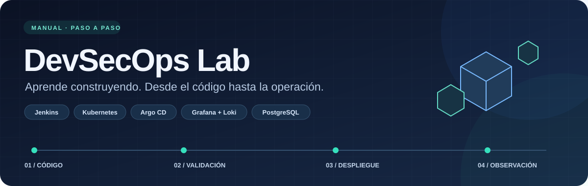
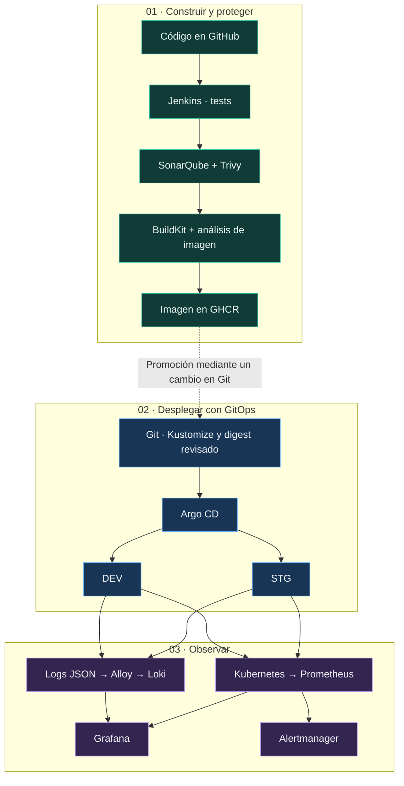

<div align="center">



# Manual del laboratorio DevSecOps

**Un laboratorio local. Todo el recorrido: construir, proteger, desplegar y observar.**


[Comenzar la práctica](#3-preparar-windows-y-ubuntu) · [Última actualización](#19-actualización-jenkins-y-entornos-efímeros) · [Resolver un problema](#17-dificultades-y-soluciones)

</div>

> [!TIP]
> **¿Es tu primer laboratorio?** Sigue los temas en orden y comprueba el resultado de cada paso antes de continuar. Los comandos de Windows y Ubuntu están identificados en cada bloque.

---

## Índice

### Tu ruta de aprendizaje

| Etapa | Qué vas a conseguir | Temas |
| :--- | :--- | :---: |
| 🧭 **Preparar** | Entender las piezas y dejar listo tu equipo | [01–04](#1-objetivo-y-alcance) |
| 🛠️ **Construir y proteger** | Crear el clúster, probar la aplicación y configurar CI | [05–08](#5-crear-kubernetes-con-kind) |
| 🚀 **Desplegar** | Separar DEV/STG con GitOps y escalar la aplicación | [09–10](#9-desplegar-con-argo-cd-y-kustomize) |
| 📊 **Observar** | Consultar métricas, analizar logs y detectar errores | [11–13](#11-prometheus-y-grafana) |
| 💾 **Conservar y recuperar** | Trabajar con volúmenes, PostgreSQL y backups | [14–15](#14-almacenamiento-persistente) |
| ⚙️ **Operar y automatizar** | Consultar con MCP, resolver incidentes y gestionar TTL | [16–20](#16-acceso-mcp-de-solo-lectura) |

<details>
<summary><strong>Ver el índice completo · 20 temas</strong></summary>

1. [Objetivo y alcance](#1-objetivo-y-alcance)
2. [Conceptos básicos](#2-conceptos-básicos)
3. [Preparar Windows y Ubuntu](#3-preparar-windows-y-ubuntu)
4. [Organizar los archivos](#4-organizar-los-archivos)
5. [Crear Kubernetes con kind](#5-crear-kubernetes-con-kind)
6. [Ejecutar y probar la aplicación](#6-ejecutar-y-probar-la-aplicación)
7. [Levantar Jenkins y SonarQube](#7-levantar-jenkins-y-sonarqube)
8. [Configurar el pipeline de seguridad](#8-configurar-el-pipeline-de-seguridad)
9. [Desplegar con Argo CD y Kustomize](#9-desplegar-con-argo-cd-y-kustomize)
10. [Métricas y escalado automático](#10-métricas-y-escalado-automático)
11. [Prometheus y Grafana](#11-prometheus-y-grafana)
12. [Logs con Alloy y Loki](#12-logs-con-alloy-y-loki)
13. [Dashboard y alerta de errores HTTP](#13-dashboard-y-alerta-de-errores-http)
14. [Almacenamiento persistente](#14-almacenamiento-persistente)
15. [PostgreSQL y copias de seguridad](#15-postgresql-y-copias-de-seguridad)
16. [Acceso MCP de solo lectura](#16-acceso-mcp-de-solo-lectura)
17. [Dificultades y soluciones](#17-dificultades-y-soluciones)
18. [Operación diaria y comprobación final](#18-operación-diaria-y-comprobación-final)
19. [Actualización: Jenkins y entornos efímeros](#19-actualización-jenkins-y-entornos-efímeros)
20. [Referencias](#20-referencias)

</details>

---

## 1. Objetivo y alcance

Construiremos un entorno local para probar una aplicación, analizar su calidad y seguridad, publicar una imagen y desplegarla en Kubernetes. Después aprenderemos a consultar métricas y logs, detectar errores y recuperar datos.

El recorrido es:



Este manual se elaboró el **10 de noviembre de 2026** y se actualizó el **12 de noviembre de 2026** a partir de los archivos reales de `~/laboratorios/devsecops`, consultas de estado del clúster y el historial disponible. Los comandos de instalación son instrucciones para el lector: no se han reinstalado componentes ni ejecutado ejercicios destructivos al escribir el documento. La última actualización incorpora el pipeline de operaciones de Jenkins y las pruebas del limpiador automático de entornos efímeros; consulta el tema 19.

Se incluyen configuraciones revisadas en [materiales](materiales/). El código de la aplicación se obtiene de GitHub. No se distribuyen contraseñas, tokens, kubeconfigs administrativos, bases de datos ni cachés. Los experimentos antiguos de correo y las copias de manifiestos internos del control plane no forman parte del recorrido de instalación: no hay evidencia suficiente para reproducir su resultado con seguridad. El menú de operaciones y el limpiador TTL ya tienen implementación; todavía quedan comprobaciones y mejoras indicadas en el tema 19.

<details>
<summary><strong>📦 Consultar versiones y configuración del entorno</strong></summary>


| Componente | Versión o configuración observada |
|---|---|
| Docker Engine | 29.9.1 |
| kind | 0.30.0; un control plane y dos workers |
| kubectl / Helm | 1.37.1 / 3.22.1 |
| Aplicación | Node.js 22, Express, Pino; package.json 3.0.0 |
| Argo CD | 3.5.5 |
| Metrics Server | 0.9.0 |
| Chart de monitorización | kube-prometheus-stack 92.11.0 |
| Chart de Loki | 7.5.0 |
| Chart de Alloy | 1.14.2 |

Estas son versiones registradas del entorno, no una garantía de compatibilidad con cualquier equipo. Algunas imágenes originales usan etiquetas móviles (`latest`, `community`, `lts-jdk21`); para conservar exactamente una ejecución hay que registrar también sus digests y la versión de Kubernetes del clúster.

</details>

[↑ Volver al índice](#índice)

---

## 2. Conceptos básicos

| Término | Significado práctico |
|---|---|
| Terminal | Ventana donde escribimos comandos. |
| Imagen / contenedor | Paquete de una aplicación / ejecución de ese paquete. |
| Pod | Unidad de ejecución de Kubernetes; puede reemplazarse y cambiar de IP. |
| Deployment | Mantiene los pods de una aplicación y gestiona sus actualizaciones. |
| Service | Dirección estable para acceder a los pods. |
| Namespace | División lógica del clúster para separar prácticas o entornos. |
| PVC / PV | Petición de almacenamiento / volumen que la satisface. |
| StatefulSet | Gestiona aplicaciones con identidad y almacenamiento estables. |
| Secret | Recurso para credenciales; no debe publicarse en Git. |
| CI / GitOps | Validar y construir código / desplegar el estado declarado en Git. |
| Digest | Identificador del contenido de una imagen: `sha256:...`. |
| HPA | Ajusta el número de réplicas en función de métricas. |

Los bloques `powershell` se ejecutan en Windows. Los bloques `bash`, en Ubuntu WSL2. No copies el indicador `$` de una terminal. En los bloques YAML se indica cómo guardar o aplicar el contenido. `Ctrl+C` detiene un servidor o un reenvío de puertos, pero no elimina la aplicación del clúster.

[↑ Volver al índice](#índice)

---

## 3. Preparar Windows y Ubuntu

Necesitas Windows con WSL2, Ubuntu, Docker con integración WSL, Git, Node.js 22, kubectl, kind y Helm. Como orientación para este conjunto de servicios, conviene disponer de 16 GB de RAM o más y varias decenas de GB libres; no es un mínimo medido.

En PowerShell con permisos de administrador, si todavía no tienes Ubuntu:

```powershell
wsl --install -d Ubuntu
wsl --list --verbose
```

Reinicia Windows si se solicita y completa la creación de usuario en Ubuntu. Si utilizas Docker Desktop, activa su motor WSL2 y la integración con Ubuntu. Evita mantener dos motores Docker distintos sin saber cuál utiliza tu terminal.

En Ubuntu:

```bash
sudo apt update
sudo apt install -y git curl ca-certificates python3 openssl
docker version
docker compose version
node --version
npm --version
kubectl version --client
kind version
helm version --short
```

Si falta una herramienta, instálala mediante sus instrucciones oficiales del apartado de referencias. Node debe ser de la rama 22 para seguir este laboratorio. `docker version` debe mostrar también el servidor: si solo aparece el cliente, comprueba Docker antes de continuar.

[↑ Volver al índice](#índice)

---

## 4. Organizar los archivos

Descarga o copia **este README junto con la carpeta `materiales`**. En Ubuntu, sitúate en la carpeta que contiene ambos y ejecuta:

```bash
mkdir -p ~/laboratorios/devsecops
cp -R materiales/. ~/laboratorios/devsecops/
export LAB_ROOT="$HOME/laboratorios/devsecops"
mkdir -p "$LAB_ROOT/app"
git clone https://github.com/pivito/app-demo-devsecops.git "$LAB_ROOT/app/app-demo"
cd "$LAB_ROOT/app/app-demo"
git switch feature/gitops-kustomize
git status -sb
```

Si la aplicación ya está clonada, omite `git clone` y revisa `git status` antes de cambiar de rama. Para conservar la revisión usada en la recuperación documentada puedes consultar el commit `9d81843986fabf3d179269bc7811deb5162d7467`; el contenido futuro de la rama puede cambiar.

Para publicar cambios propios, crea un fork y utiliza su URL y tu usuario de GHCR en los pasos posteriores. Si el repositorio no es accesible, necesitarás acceso o una copia del autor; el código de la aplicación no se incluye en `materiales`.

```text
~/laboratorios/devsecops/
├── app/app-demo/       Código, tests, Dockerfile, Jenkinsfile y Kustomize
├── infra/             Docker Compose e imagen personalizada de Jenkins
├── kind/              Configuración del clúster
├── logging/           Valores de Loki y Alloy
├── monitoring/        Valores de Prometheus/Grafana y alerta de ejemplo
├── storage/           Práctica de volúmenes
├── postgres/          Base de datos y backups
└── mcp-kubernetes/    RBAC y script de renovación de token
```

Cada terminal nueva necesita de nuevo `export LAB_ROOT="$HOME/laboratorios/devsecops"`, o usar las rutas completas con `~` que aparecen en los ejemplos.

[↑ Volver al índice](#índice)

---

## 5. Crear Kubernetes con kind

```bash
cd ~/laboratorios/devsecops
cat kind/kind-config.yaml
kind get clusters
# Ejecuta la siguiente línea solo si todavía no existe devsecops:
kind create cluster --name devsecops --config kind/kind-config.yaml
kubectl config use-context kind-devsecops
kubectl get nodes -o wide
kubectl get pods -A
kubectl get storageclass
```

Resultado esperado: tres nodos `Ready` y una clase de almacenamiento `standard`. Si un pod está arrancando, espera y repite la consulta. Para investigar un fallo usa `kubectl describe pod NOMBRE -n NAMESPACE` y revisa los eventos al final.

[↑ Volver al índice](#índice)

---

## 6. Ejecutar y probar la aplicación

```bash
cd ~/laboratorios/devsecops/app/app-demo
npm ci
npm test
APP_ENV=local ENABLE_TEST_ENDPOINTS=true node index.js
```

Mantén esa terminal abierta. En otra terminal Ubuntu:

```bash
curl http://localhost:3000/
curl http://localhost:3000/health
curl http://localhost:3000/version
curl -i http://localhost:3000/test-error
```

`/health` devuelve `{"status":"UP"}`. `/version` muestra versión y entorno. `/test-error` devuelve **500 de forma intencionada** y solo existe cuando `ENABLE_TEST_ENDPOINTS=true`. Sin esa variable, un 404 es el comportamiento esperado. La aplicación escribe logs JSON con Pino y oculta campos sensibles de cabeceras.

Para construir y probar una imagen local, detén antes el servidor con `Ctrl+C`:

```bash
docker build -t app-demo:local .
docker run --rm --name app-demo-local -p 127.0.0.1:3000:3000 app-demo:local
```

El Dockerfile tiene dos etapas y ejecuta la aplicación con el usuario `node`.

[↑ Volver al índice](#índice)

---

## 7. Levantar Jenkins y SonarQube

El PostgreSQL de Docker Compose es la base de SonarQube. Es independiente del PostgreSQL que crearemos en Kubernetes.

```bash
cd ~/laboratorios/devsecops/infra
umask 077
# Solo si todavía no existe .env:
if [ ! -f .env ]; then
  printf 'SONAR_DB_USER=sonar\nSONAR_DB_NAME=sonar\nSONAR_DB_PASSWORD=%s\n' \
    "$(openssl rand -hex 24)" > .env
fi
chmod 600 .env
docker compose up -d --build
docker compose ps
docker compose logs --tail=60 sonarqube
```

No publiques `.env`. Cambiar una contraseña en ese archivo no cambia automáticamente la de una base de datos ya inicializada.

| Servicio | Acceso desde el navegador |
|---|---|
| Jenkins | http://localhost:8080 |
| SonarQube | http://localhost:9000 |
| BuildKit / Trivy | Servicios internos de la red Compose |

Obtén la contraseña inicial de Jenkins en tu terminal privada:

```bash
docker compose exec jenkins cat /var/jenkins_home/secrets/initialAdminPassword
```

Completa el asistente de Jenkins y crea tu usuario. Inicializa SonarQube y cambia su contraseña inicial. Si SonarQube no arranca, consulta sus logs; un error de `vm.max_map_count` debe resolverse en el host Linux que ejecuta Docker, siguiendo los requisitos de SonarQube.

[↑ Volver al índice](#índice)

---

## 8. Configurar el pipeline de seguridad

En **Manage Jenkins**, instala los plugins necesarios para Pipeline, Git, NodeJS y SonarQube Scanner. Los nombres de las herramientas deben coincidir exactamente con el `Jenkinsfile`:

| Configuración | Nombre usado por el pipeline |
|---|---|
| Instalación NodeJS 22 | `NodeJS-22` |
| Instalación SonarScanner | `SonarScanner` |
| Servidor SonarQube | `SonarQube-Local` |
| Credencial de GHCR, usuario y token | `ghcr-credentials` |

Configura SonarQube en Jenkins con URL interna `http://sonarqube:9000` y un token guardado como credencial. En SonarQube crea el proyecto `app-demo` y un webhook a `http://jenkins:8080/sonarqube-webhook/`. El webhook permite que `waitForQualityGate` reciba el resultado.

En GitHub, prepara acceso a GHCR con permiso para publicar paquetes. Guarda el usuario y token en Jenkins; no los escribas en el Jenkinsfile. Si usas un fork, sustituye `ghcr.io/pivito/app-demo-devsecops` por tu ruta en el pipeline y en Kustomize.

Crea un trabajo Pipeline llamado `app-demo-ci`, selecciona **Pipeline script from SCM → Git**, configura tu repositorio, la rama `feature/gitops-kustomize` y `Jenkinsfile` como ruta. Pulsa **Build Now**.

Las etapas reales son:

1. Descargar el código y ejecutar `npm ci`.
2. Ejecutar `npm test`.
3. Analizar con SonarQube y esperar el Quality Gate.
4. Analizar dependencias con Trivy; HIGH o CRITICAL provoca fallo.
5. Construir con BuildKit un archivo `app-demo-ci.tar`.
6. Analizar esa imagen con Trivy y archivar informes JSON.
7. Publicar en GHCR con Skopeo, usando los primeros 12 caracteres del commit como etiqueta.

Un fallo del análisis debe investigarse en el informe: actualiza dependencias o la imagen base y vuelve a ejecutar. No elimines el control de seguridad para obtener una ejecución verde.

**Límite del pipeline actual:** publica la imagen, pero no actualiza automáticamente los digests de Kustomize. El siguiente paso de promoción sigue siendo un cambio revisado en Git.

[↑ Volver al índice](#índice)

---

## 9. Desplegar con Argo CD y Kustomize

### 9.1 Instalar Argo CD en un clúster nuevo

Si ya existe el namespace y Argo CD funciona, omite su instalación. Para un entorno nuevo:

```bash
kubectl create namespace argocd
kubectl apply -n argocd --server-side \
  -f https://raw.githubusercontent.com/argoproj/argo-cd/v3.5.5/manifests/install.yaml
kubectl -n argocd rollout status deployment/argocd-server --timeout=300s
kubectl -n argocd port-forward svc/argocd-server 8081:443
```

Abre https://localhost:8081. En el laboratorio el certificado puede ser autofirmado. Para recuperar la contraseña inicial de `admin`, en otra terminal:

```bash
kubectl -n argocd get secret argocd-initial-admin-secret \
  -o jsonpath='{.data.password}' | base64 -d
printf '\n'
```

Si ya se completó la inicialización y ese Secret fue eliminado, utiliza las credenciales configuradas; no reinstales Argo CD.

### 9.2 Preparar namespaces y acceso a imágenes

```bash
kubectl create namespace app-demo-dev --dry-run=client -o yaml | kubectl apply -f -
kubectl create namespace app-demo-stg --dry-run=client -o yaml | kubectl apply -f -
```

El Deployment referencia `ghcr-secret`. Para imágenes privadas, créalo en **cada namespace**, con tu usuario y un token de lectura de paquetes:

```bash
read -rp 'Usuario de GitHub: ' GHCR_USER
read -rsp 'Token de lectura de GHCR: ' GHCR_TOKEN; printf '\n'
for ns in app-demo-dev app-demo-stg; do
  kubectl -n "$ns" create secret docker-registry ghcr-secret \
    --docker-server=ghcr.io --docker-username="$GHCR_USER" \
    --docker-password="$GHCR_TOKEN" --dry-run=client -o yaml | kubectl apply -f -
done
unset GHCR_TOKEN GHCR_USER
```

Hazlo en una terminal privada. El comando evita guardar el valor literal en el historial, aunque durante su ejecución el token se entrega como argumento al proceso. El acceso de Argo CD a un repositorio Git privado se configura aparte en **Settings → Repositories**.

### 9.3 Entender y registrar DEV y STG

```bash
cd ~/laboratorios/devsecops/app/app-demo
kubectl kustomize k8s/overlays/dev
kubectl kustomize k8s/overlays/stg
```

Estos comandos solo muestran los manifiestos finales. Comprueba el namespace y la imagen antes de desplegar.

| Entorno | Ruta | Réplicas iniciales | HPA | Variables |
|---|---|---:|---|---|
| DEV | `k8s/overlays/dev` | 1 | 1–4 | `APP_ENV=development`, endpoint de prueba activo |
| STG | `k8s/overlays/stg` | 2 | 2–6 | `APP_ENV=staging`, endpoint de prueba desactivado |

En Argo CD, crea una Application por entorno con estos valores:

| Campo | DEV | STG |
|---|---|---|
| Application Name | `app-demo-dev` | `app-demo-stg` |
| Project | `default` | `default` |
| Repository URL | Tu fork o `https://github.com/pivito/app-demo-devsecops.git` | El mismo |
| Revision | `feature/gitops-kustomize` | La misma |
| Path | `k8s/overlays/dev` | `k8s/overlays/stg` |
| Cluster URL | `https://kubernetes.default.svc` | El mismo |
| Namespace | `app-demo-dev` | `app-demo-stg` |

En DEV activa sincronización automática y `Self Heal`, dejando `Prune` desactivado, como en la configuración observada. Para una instalación de aprendizaje deja STG en sincronización manual y revisa su diferencia antes de sincronizar. No necesitas crear la aplicación histórica `app-demo`, que apuntaba a `main/k8s`, para seguir este recorrido.

Tras sincronizar:

```bash
kubectl -n argocd get applications
kubectl -n app-demo-dev rollout status deployment/app-demo --timeout=180s
kubectl -n app-demo-stg rollout status deployment/app-demo --timeout=180s
kubectl -n app-demo-dev port-forward svc/app-demo 3311:80
```

Abre http://localhost:3311 y prueba `/health` y `/version`. Para STG usa otra terminal y el puerto `3310`:

```bash
kubectl -n app-demo-stg port-forward svc/app-demo 3310:80
```

### 9.4 Publicar una versión y volver atrás

Obtén el digest de la imagen publicada desde GHCR o con Skopeo. Si es privada, autentica primero el cliente con permisos de lectura:

```bash
# Sustituye la etiqueta por la que aparece en la salida de Jenkins.
skopeo inspect docker://ghcr.io/pivito/app-demo-devsecops:ETIQUETA \
  --format '{{.Digest}}'
```

Edita el campo `images[].digest` de `k8s/overlays/dev/kustomization.yaml`, sin cambiar STG. Después:

```bash
git diff -- k8s/overlays/dev/kustomization.yaml
kubectl kustomize k8s/overlays/dev > /tmp/app-demo-dev-rendered.yaml
git add k8s/overlays/dev/kustomization.yaml
git commit -m "Actualizar imagen de DEV"
git push origin feature/gitops-kustomize
kubectl -n argocd get application app-demo-dev
```

Argo CD debe llegar a `Synced` y `Healthy`. Para promocionar, cambia explícitamente el digest de STG y revisa ese cambio. Para volver atrás, revierte en Git el commit que cambió la imagen y publícalo; no uses `kubectl set image` como procedimiento normal, porque `Self Heal` puede deshacerlo.

[↑ Volver al índice](#índice)

---

## 10. Métricas y escalado automático

El HPA necesita Metrics Server. En un clúster nuevo, instala la versión observada:

```bash
kubectl apply -f https://github.com/kubernetes-sigs/metrics-server/releases/download/v0.9.0/components.yaml
kubectl -n kube-system rollout status deployment/metrics-server --timeout=180s
kubectl top nodes
kubectl -n app-demo-dev top pods
kubectl -n app-demo-dev get hpa
```

Si sus logs muestran que no puede validar el certificado del kubelet, en **este laboratorio local** puedes añadir el ajuste utilizado en el entorno original:

```bash
kubectl -n kube-system logs deployment/metrics-server --tail=50
kubectl -n kube-system patch deployment metrics-server --type=json \
  -p='[{"op":"add","path":"/spec/template/spec/containers/0/args/-","value":"--kubelet-insecure-tls"}]'
```

El ajuste desactiva esa validación TLS; no debe trasladarse automáticamente a producción. El HPA usa CPU respecto al `request` de 50m, con objetivo del 50 %. Una petición aislada puede no generar carga suficiente para escalar. Las métricas pueden tardar en aparecer tras arrancar.

[↑ Volver al índice](#índice)

---

## 11. Prometheus y Grafana

En una instalación nueva, crea primero el Secret requerido por el archivo de valores:

```bash
kubectl create namespace monitoring --dry-run=client -o yaml | kubectl apply -f -
read -rsp 'Nueva contraseña de Grafana: ' GRAFANA_PASSWORD; printf '\n'
kubectl -n monitoring create secret generic grafana-admin \
  --from-literal=admin-user=admin --from-literal=admin-password="$GRAFANA_PASSWORD" \
  --dry-run=client -o yaml | kubectl apply -f -
unset GRAFANA_PASSWORD
helm repo add prometheus-community https://prometheus-community.github.io/helm-charts
helm repo update
helm upgrade --install monitoring prometheus-community/kube-prometheus-stack \
  --version 92.11.0 -n monitoring \
  -f ~/laboratorios/devsecops/monitoring/values.yaml
kubectl -n monitoring get pods,pvc
kubectl -n monitoring port-forward svc/monitoring-grafana 3001:80
```

Abre http://localhost:3001 con `admin` y la contraseña elegida. Prometheus conserva tres días de datos y solicita un PVC de 5 GiB. Grafana tiene **persistencia desactivada** en el archivo original: exporta los dashboards y reglas que quieras conservar antes de recrear su pod.

Para consultar Prometheus en otra terminal:

```bash
kubectl -n monitoring port-forward svc/monitoring-kube-prometheus-prometheus 9090:9090
```

Abre http://localhost:9090 y comprueba targets y métricas. El archivo `monitoring/alerts/app-demo-alerts.yaml` contiene una regla histórica para el namespace `app-demo`. Para usarla en DEV, copia el archivo, cambia su nombre de recurso y su selector a `app-demo-dev`, y aplícala con `kubectl apply -f RUTA_DEL_ARCHIVO`. Aplicar el original sin adaptarlo vigilaría el entorno antiguo.

[↑ Volver al índice](#índice)

---

## 12. Logs con Alloy y Loki

```bash
helm repo add grafana https://grafana.github.io/helm-charts
helm repo update
kubectl create namespace logging --dry-run=client -o yaml | kubectl apply -f -
helm upgrade --install loki grafana/loki --version 7.5.0 -n logging \
  -f ~/laboratorios/devsecops/logging/loki-values.yaml
helm upgrade --install alloy grafana/alloy --version 1.14.2 -n logging \
  -f ~/laboratorios/devsecops/logging/alloy-values.yaml
kubectl -n logging get pods,pvc
kubectl -n logging logs daemonset/alloy --tail=50
```

Loki usa modo SingleBinary, filesystem y PVC de 5 GiB. El archivo declara `retention_period: 168h`; no se ha verificado aquí el borrado efectivo por retención. Alloy se ejecuta como DaemonSet y selecciona únicamente pods de su nodo mediante `HOST_NODE_NAME`, evitando que todos los agentes recojan indiscriminadamente los mismos pods.

En Grafana, añade una fuente de datos **Loki** con URL:

```text
http://loki-gateway.logging.svc.cluster.local
```

Pulsa **Save & test**. Esa dirección se usa desde Grafana dentro de Kubernetes; no se abre directamente en el navegador de Windows. En **Explore**, selecciona Loki y consulta:

```logql
{namespace="app-demo-dev"}
```

Genera peticiones a DEV y comprueba que aparecen logs recientes. Si no aparecen, verifica el rango temporal, el namespace, los pods de Alloy y la conectividad con el gateway.

[↑ Volver al índice](#índice)

---

## 13. Dashboard y alerta de errores HTTP

### 13.1 Crear el panel

En Grafana crea un dashboard y un panel de serie temporal con Loki. Para contar respuestas 5xx por minuto:

```logql
sum(
  count_over_time(
    {namespace="app-demo-dev"}
    | json
    | __error__=""
    | res_statusCode >= 500
    [1m]
  )
) or vector(0)
```

Guárdalo como **Errores por minuto - app-demo**. El campo `res_statusCode` procede de analizar el objeto JSON `res.statusCode`. Contar simplemente el texto de nivel `error` puede contar registros distintos de la respuesta HTTP.

### 13.2 Configurar la alerta

En **Alerting → Alert rules → New alert rule**:

| Campo | Valor |
|---|---|
| Nombre | `DEV - HTTP 5xx elevado` |
| Fuente y consulta | Loki; expresión anterior, tipo Instant si está disponible |
| Condición | `Is above 4`, equivalente a cinco o más errores enteros |
| Carpeta | `DevSecOps - Alertas` |
| Grupo / intervalo | `devsecops-evaluation` / 1 minuto |
| Pending / Keep firing | None / None |
| Labels | `environment=dev`, `application=app-demo`, `severity=warning` |
| No Data / Error | Mantener estados diferenciados |

Si el editor requiere expresiones, añade Reduce `Last` sobre A y Threshold `Is above 4` sobre la reducción. Vincula el panel y guarda la regla. El envío externo de notificaciones queda fuera de este recorrido; el usuario decidió no continuar configurando un canal.

### 13.3 Generar y detener errores

Mantén el `port-forward` de DEV al puerto 3311 y ejecuta:

```bash
for i in $(seq 1 90); do
  curl -s -o /dev/null -w "Petición $i: HTTP %{http_code}\n" \
    http://localhost:3311/test-error
  sleep 1
done
```

Durante la prueba se esperan respuestas 500. Revisa el pico del panel y la transición de la alerta a `Firing`. Al terminar el bucle, debe recuperarse en una evaluación posterior sin suficiente número de errores. La ventana y el intervalo de evaluación hacen que el cambio no sea instantáneo.

El historial confirma la visualización del pico en el dashboard y la configuración guiada de la regla. No hay una evidencia adjunta de todo el ciclo `Normal → Firing → Normal`; compruébalo como parte del ejercicio.

[↑ Volver al índice](#índice)

---

## 14. Almacenamiento persistente

```bash
cd ~/laboratorios/devsecops
kubectl create namespace storage-lab --dry-run=client -o yaml | kubectl apply -f -
kubectl apply -f storage/pvc.yaml
kubectl apply -f storage/pod.yaml
kubectl -n storage-lab wait --for=condition=Ready pod/storage-test --timeout=120s
kubectl -n storage-lab exec storage-test -- sh -c 'echo "Dato persistente" > /datos/prueba.txt'
kubectl -n storage-lab exec storage-test -- cat /datos/prueba.txt
```

Para demostrar que el dato sobrevive al pod, elimina **solo el pod de esta práctica** y vuelve a crearlo:

```bash
kubectl -n storage-lab delete pod storage-test
kubectl apply -f storage/pod.yaml
kubectl -n storage-lab wait --for=condition=Ready pod/storage-test --timeout=120s
kubectl -n storage-lab exec storage-test -- cat /datos/prueba.txt
```

El archivo debe seguir ahí. Un PVC no es una copia de seguridad: kind almacena estos datos dentro del entorno local de sus nodos y perder el clúster puede perderlos.

Los archivos `pvc-recuperada.yaml` y `pod-recuperado.yaml` documentan una recuperación anterior. **No apliques directamente el PVC recuperado:** contiene un `volumeName` concreto del equipo original. Para practicar recuperación necesitas identificar tu PV, configurar previamente `Retain`, entender su `claimRef` y adaptar el manifiesto. Esta operación se deja como ejercicio avanzado, porque puede afectar al vínculo con los datos.

[↑ Volver al índice](#índice)

---

## 15. PostgreSQL y copias de seguridad

### 15.1 Crear la base de datos

```bash
cd ~/laboratorios/devsecops
kubectl create namespace postgres-lab --dry-run=client -o yaml | kubectl apply -f -
read -rsp 'Contraseña de PostgreSQL de laboratorio: ' PG_LAB_PASSWORD; printf '\n'
kubectl -n postgres-lab create secret generic postgres-secret \
  --from-literal=POSTGRES_PASSWORD="$PG_LAB_PASSWORD" \
  --dry-run=client -o yaml | kubectl apply -f -
unset PG_LAB_PASSWORD
kubectl apply -f postgres/service.yaml
kubectl apply -f postgres/statefulset.yaml
kubectl -n postgres-lab rollout status statefulset/postgres --timeout=180s
kubectl -n postgres-lab exec -it postgres-0 -- psql -U laboratorio -d laboratorio
```

Dentro de `psql`, crea un dato de prueba:

```sql
CREATE TABLE IF NOT EXISTS prueba_manual (id integer PRIMARY KEY, texto text);
INSERT INTO prueba_manual VALUES (1, 'Backup del laboratorio')
ON CONFLICT (id) DO UPDATE SET texto = EXCLUDED.texto;
SELECT * FROM prueba_manual;
\q
```

### 15.2 Programar y comprobar backups

```bash
kubectl apply -f postgres/backup-pvc.yaml
kubectl apply -f postgres/backup-cronjob.yaml
kubectl -n postgres-lab get cronjobs
BACKUP_JOB="postgres-backup-manual-$(date +%s)"
kubectl -n postgres-lab create job --from=cronjob/postgres-backup "$BACKUP_JOB"
kubectl -n postgres-lab wait --for=condition=complete "job/$BACKUP_JOB" --timeout=180s
kubectl -n postgres-lab logs "job/$BACKUP_JOB"
kubectl apply -f postgres/backup-inspector.yaml
kubectl -n postgres-lab wait --for=condition=Ready pod/backup-inspector --timeout=120s
kubectl -n postgres-lab exec backup-inspector -- ls -lh /backups
```

El CronJob está programado a las **02:00, Europe/Madrid**, impide ejecuciones simultáneas y genera dumps de formato personalizado. Comprueba el índice con `pg_restore -l` y elimina archivos coincidentes de más de seis días según `find -mtime +6`. Esa comprobación de índice no sustituye una restauración real. Si WSL o el clúster están apagados, no hay garantía de ejecución puntual; el manifiesto tiene un margen de inicio de una hora.

### 15.3 Restaurar en una base separada

Elige un nombre real de la lista anterior, sin copiar literalmente `NOMBRE.dump`:

```bash
mkdir -p ~/laboratorios/backups
kubectl -n postgres-lab cp backup-inspector:/backups/NOMBRE.dump \
  ~/laboratorios/backups/laboratorio.dump
kubectl -n postgres-lab cp ~/laboratorios/backups/laboratorio.dump \
  postgres-0:/tmp/laboratorio-restauracion.dump
kubectl -n postgres-lab exec postgres-0 -- \
  createdb -U laboratorio laboratorio_restauracion
kubectl -n postgres-lab exec postgres-0 -- \
  pg_restore -U laboratorio -d laboratorio_restauracion --no-owner --exit-on-error \
  /tmp/laboratorio-restauracion.dump
kubectl -n postgres-lab exec postgres-0 -- \
  psql -U laboratorio -d laboratorio_restauracion -c 'SELECT * FROM prueba_manual;'
```

Si `laboratorio_restauracion` ya existe, elige otra base nueva y usa su nombre en los comandos. No sobrescribas la original. Conserva una copia adicional fuera de los nodos de kind: el PVC de backups tampoco protege frente a perder el clúster completo.

[↑ Volver al índice](#índice)

---

## 16. Acceso MCP de solo lectura

El material incluye un ServiceAccount, Role y RoleBinding limitados al namespace histórico `app-demo`. Permiten consultar recursos y logs; no permiten modificar recursos ni leer Secrets. No dan acceso automáticamente a DEV o STG.

```bash
kubectl create namespace app-demo --dry-run=client -o yaml | kubectl apply -f -
kubectl apply -f ~/laboratorios/devsecops/mcp-kubernetes/rbac/kubernetes-mcp-readonly.yaml
kubectl auth can-i list pods -n app-demo \
  --as=system:serviceaccount:app-demo:kubernetes-mcp
kubectl auth can-i delete pods -n app-demo \
  --as=system:serviceaccount:app-demo:kubernetes-mcp
```

Se espera `yes` para listar y `no` para eliminar. Para otros namespaces hay que diseñar sus bindings de forma explícita.

El script `mcp-kubernetes/scripts/renew-token.sh` genera un token solicitado por 24 horas y un kubeconfig reducido. Antes de usarlo, cambia sus rutas fijas `/home/migue/...` por las de tu usuario, crea el directorio `config` y revisa el resultado. Mantiene solo el usuario y contexto del ServiceAccount, pero contiene un token sensible. No se incluyen el kubeconfig ni la configuración del cliente MCP del autor. La conexión al cliente queda pendiente de configurar en cada equipo; la caducidad efectiva del token depende del servidor.

[↑ Volver al índice](#índice)

---

## 17. Dificultades y soluciones

### 17.1 Incidente confirmado: Argo CD no resolvía DNS

**Síntoma:** Repo Server no resolvía GitHub y el controlador no resolvía el servicio Repo Server. Un BusyBox nuevo, incluso en el mismo worker y con el mismo DNS, sí resolvía.

**Investigación:** se compararon `resolv.conf`, rutas, vecinos ARP, políticas de red y respuestas de CoreDNS. La diferencia determinante fue que los pods afectados estaban seleccionados por NetworkPolicy y su tráfico pasaba por una cola de kindnet. La tabla nftables `inet kindnet-network-policies` los enviaba a NFQUEUE 101; BusyBox no estaba en ese grupo.

**Causa operativa demostrada:** atasco de la cola de procesamiento de políticas de kindnet. Había 712 paquetes pendientes en un worker y 301 en el otro. Los agentes figuraban `Running`, lo cual no garantizaba que procesaran correctamente el tráfico. La antigüedad de los pods no era la explicación.

Comprobaciones útiles antes de intervenir:

```bash
kubectl -n argocd exec deployment/argocd-repo-server -- cat /etc/resolv.conf
kubectl -n argocd exec deployment/argocd-repo-server -- timeout 10 getent hosts github.com
kubectl -n kube-system get pods -l app=kindnet -o wide
docker exec devsecops-worker cat /proc/net/netfilter/nfnetlink_queue
docker exec devsecops-worker nft list table inet kindnet-network-policies
```

**Solución aplicada:** guardar evidencias y recrear secuencialmente el pod kindnet de cada worker afectado, verificando la recuperación antes de pasar al siguiente. Se conservaron NetworkPolicy y CoreDNS y no se recreó Repo Server.

Si se reproduce el mismo diagnóstico, identifica el nombre actual del pod kindnet en el worker afectado. Los nombres antiguos no son reutilizables. Reiniciar un agente de red puede interrumpir temporalmente la conectividad de los pods de ese nodo, también de otros namespaces:

```bash
# Sustituye NOMBRE por un único pod kindnet previamente identificado.
kubectl -n kube-system delete pod NOMBRE
kubectl -n kube-system rollout status daemonset/kindnet --timeout=120s
kubectl -n argocd exec deployment/argocd-repo-server -- timeout 10 getent hosts github.com
kubectl -n argocd annotate application app-demo-dev \
  argocd.argoproj.io/refresh=hard --overwrite
kubectl -n argocd get application app-demo-dev
```

El hard refresh vuelve a obtener y comparar el estado; la sincronización posterior depende de la política de la Application. No reinicies todos los agentes indiscriminadamente.

**Resultado documentado:** las colas quedaron a cero, el Repo Server original recuperó GitHub y DEV sincronizó automáticamente el commit `9d81843`, con estado `Synced / Healthy`. Se compararon UID, especificaciones y operación de STG antes y después: permanecieron iguales. **El desencadenante del atasco no está demostrado**; tampoco se ha probado que el límite de CPU lo causara ni que la recuperación impida recurrencias. Consulta el [informe completo](evidencias/incidente-dns-argocd.md).

### 17.2 Ajustes documentados durante la observabilidad

| Dificultad o límite | Ajuste recogido en la práctica |
|---|---|
| `Is above 5` no significa cinco o más | Se corrigió a `Is above 4` para contar al menos cinco errores enteros. |
| Diferenciar mensajes de error de respuestas HTTP | Consulta de logs JSON con filtro `res_statusCode >= 500`. |
| Contar cero cuando no hay respuestas coincidentes | Se añadió `or vector(0)`; sigue siendo necesario vigilar por separado la salud de la recolección. |
| Atribuir entorno y versión a los logs | Pino añade `application`, `environment` y `version`. |
| Evitar recoger todos los pods desde cada agente | Alloy limita el descubrimiento al nodo de cada DaemonSet. |
| Acceder a pods desde Windows | Se usa Service con `port-forward`; una IP de pod no es una dirección estable ni necesariamente accesible desde el host. |

Estas filas describen decisiones visibles en archivos o conversaciones, no nuevos incidentes demostrados.

### 17.3 Guía general para problemas del lector

Los casos siguientes son consejos de diagnóstico; no se presentan como fallos que hayamos sufrido todos en este laboratorio.

| Síntoma | Qué comprobar y cómo avanzar |
|---|---|
| `ImagePullBackOff` | `kubectl describe pod`: existencia del digest, visibilidad de GHCR y Secret en el namespace correcto. |
| Quality Gate agotado por tiempo | Resultado en SonarQube, webhook con barra final y conectividad hacia Jenkins. |
| `npm ci` falla | Coherencia entre package.json y lockfile; usar Node 22. |
| HPA muestra `<unknown>` | Logs y disponibilidad de Metrics Server, requests de CPU y tiempo desde el arranque. |
| PVC `Pending` | Eventos, clase `standard`, provisionador y afinidad del volumen al nodo. |
| Puerto ocupado | Elegir otro puerto local en la parte izquierda de `PUERTO_LOCAL:PUERTO_SERVICIO`. |
| `/test-error` devuelve 404 | Confirmar DEV, digest desplegado y variable `ENABLE_TEST_ENDPOINTS=true`. |
| No aparecen logs | Rango de tiempo, labels, Alloy, gateway y fuente de datos de Grafana. |
| No llega un correo | Envío no validado en este manual; no confundir `Firing` con entrega de notificación. |
| Cambios manuales desaparecen | Revisar `Self Heal`; hacer el cambio persistente en Git. |

[↑ Volver al índice](#índice)

---

## 18. Operación diaria y comprobación final

Al comenzar:

```bash
docker version
kubectl config current-context
kubectl get nodes
kubectl get pods -A
cd ~/laboratorios/devsecops/infra
docker compose ps
kubectl -n argocd get applications
```

Para investigar un pod:

```bash
kubectl -n app-demo-dev get pods -o wide
kubectl -n app-demo-dev logs deployment/app-demo --tail=100
kubectl -n app-demo-dev get events --sort-by=.metadata.creationTimestamp
kubectl -n app-demo-dev get deploy,svc,hpa
```

Abre un reenvío por terminal y déjalo activo mientras lo utilices:

| Aplicación | Comando | URL |
|---|---|---|
| DEV | `kubectl -n app-demo-dev port-forward svc/app-demo 3311:80` | http://localhost:3311 |
| STG | `kubectl -n app-demo-stg port-forward svc/app-demo 3310:80` | http://localhost:3310 |
| Grafana | `kubectl -n monitoring port-forward svc/monitoring-grafana 3001:80` | http://localhost:3001 |
| Argo CD | `kubectl -n argocd port-forward svc/argocd-server 8081:443` | https://localhost:8081 |

Para entrar en un contenedor usa `kubectl exec`, sin instalar un servidor SSH:

```bash
kubectl -n app-demo-dev exec -it deployment/app-demo -- sh
# Escribe exit para salir.
```

Lista final para el alumno:

- [ ] Los tres nodos están `Ready`.
- [ ] Los tests pasan y Jenkins conserva los informes de seguridad.
- [ ] GHCR contiene la imagen del commit construido.
- [ ] DEV y STG usan sus overlays y digests revisados.
- [ ] Argo CD muestra `Synced / Healthy`.
- [ ] `/health` y `/version` responden en los puertos correctos.
- [ ] Metrics Server entrega métricas y el HPA tiene valores.
- [ ] Grafana muestra los logs y el pico intencionado de 5xx.
- [ ] Se ha observado la activación y recuperación de la alerta.
- [ ] Un dato sobrevive a recrear el pod de almacenamiento.
- [ ] Se ha creado un dump y restaurado en una base separada.
- [ ] Los permisos MCP permiten lectura y deniegan eliminación.

Al terminar, cierra los reenvíos con `Ctrl+C`. Puedes detener los servicios Compose sin eliminar volúmenes:

```bash
cd ~/laboratorios/devsecops/infra
docker compose stop
# Para arrancarlos de nuevo:
docker compose start
```

No uses `docker compose down -v` ni `kind delete cluster` como rutina para apagar: eliminan recursos y pueden hacerte perder datos. Exporta primero lo que quieras conservar.

[↑ Volver al índice](#índice)

---

## 19. Actualización: Jenkins y entornos efímeros

> [!NOTE]
> **Actualización del 12 de noviembre de 2026.** Jenkins ya permite operar entornos de prueba y el limpiador TTL tiene ejecuciones automáticas verificadas. Al final del tema se detallan las comprobaciones pendientes.

### 19.1 Qué hemos realizado — 12 de noviembre de 2026

Ya existe un pipeline independiente `app-demo-operations`, definido en `Jenkinsfile.operations`, para crear, listar y eliminar entornos temporales. También se ha desarrollado el limpiador v6, su ConfigMap y sus permisos RBAC declarativos en `k8s/operations/`.

La implementación concreta utiliza **un namespace compartido `lab-test-api`**, con un Deployment y un Service por entorno. No crea ni borra un namespace por prueba, como se había propuesto inicialmente. DEV y STG siguen separados y sus despliegues continúan mediante GitOps.

| Elemento | Estado comprobado |
|---|---|
| Pipeline de operaciones | Acciones `CREATE_TEST`, `LIST_TEST`, `DELETE_TEST` implementadas |
| Imagen de aplicación | Se introduce por digest del repositorio GHCR autorizado |
| TTL seleccionable | `30m`, `1h`, `2h`, `6h`, `12h`, `24h` |
| Limpiador | Script v6 con comprobaciones de propiedad, expiración y cambios concurrentes |
| Programación | CronJob `ephemeral-cleaner`, cada cinco minutos |
| Modo activo observado | `DRY_RUN=false`, `suspend=false`, `concurrencyPolicy=Forbid` |
| Evidencia reciente | Job `ephemeral-cleaner-29908520`, ejecutado el 12/11/2026 a las 20:20 de Madrid, completado en unos tres segundos |
| Recurso conservado | `app-test-api` omitido por no tener metadatos válidos de caducidad |
| Prueba anterior de borrado real | Job `ephemeral-cleaner-v4-real`: eliminación solicitada del Service y Deployment caducados `app-test-ttl-03` |

**Estado de publicación al revisar el laboratorio:** `58b55d2` incorpora el pipeline y `cfe488c` la primera limpieza TTL; ambos estaban en GitHub. Los commits `4980171` (v6 y RBAC) y `f2cb6d2` (activación programada) estaban guardados localmente, pero aún pendientes de publicación. Un directorio de trabajo limpio no significa que todos sus commits estén subidos. Esta actualización documental no publica esos dos commits de implementación: para reproducir v6 desde GitHub deberán publicarse previamente.

### 19.2 Utilizar el menú de Jenkins

El agente Jenkins necesita `kubectl`, conectividad con Kubernetes y una credencial de tipo **Secret file** llamada `kubeconfig-jenkins-operations`. Los permisos deben limitarse a los recursos necesarios dentro de `lab-test-api`; el kubeconfig no se guarda en el repositorio. El RBAC del limpiador no sustituye los permisos del operador de Jenkins.

Configura un trabajo Pipeline con el archivo `Jenkinsfile.operations` del repositorio y la rama del laboratorio. El pipeline usa `skipDefaultCheckout()` porque sus operaciones están definidas en el propio archivo. Tras cargar sus parámetros, usa **Build with Parameters**:

| Parámetro | Ejemplo | Significado |
|---|---|---|
| `ACTION` | `CREATE_TEST` | Crear, listar o eliminar |
| `TEST_NAME` | `test-manual-01` | Minúsculas, números y guiones; máximo 40 caracteres |
| `IMAGE` | `ghcr.io/pivito/app-demo-devsecops@sha256:...` | Digest real de 64 caracteres hexadecimales |
| `TTL` | `30m` | Tiempo solicitado hasta la caducidad |

El validador actual acepta únicamente imágenes de `ghcr.io/pivito/app-demo-devsecops`. Si utilizas un fork, adapta también esa validación. Para `CREATE_TEST`, Jenkins calcula `devsecops.io/expires-at` en UTC y crea `app-TEST_NAME`. Impide sobrescribir un Deployment o Service que ya exista con ese nombre. El manifiesto actual no declara `imagePullSecrets`: para una imagen privada prepara el acceso en el ServiceAccount del namespace o adapta el manifiesto antes de probar.

Con `TEST_NAME=test-manual-01`, comprueba el resultado desde Ubuntu:

```bash
kubectl -n lab-test-api get deployment,service,pods -o wide
kubectl -n lab-test-api get deployment app-test-manual-01 \
  -o jsonpath='{.metadata.annotations.devsecops\.io/expires-at}{"\n"}'
kubectl -n lab-test-api port-forward svc/app-test-manual-01 3312:80
```

Abre http://localhost:3312. Para entrar al contenedor desde otra terminal:

```bash
kubectl -n lab-test-api exec -it deployment/app-test-manual-01 -- sh
```

`LIST_TEST` muestra recursos del namespace. `DELETE_TEST` elimina por nombre el Deployment y el Service indicados: el pipeline actual no aplica las mismas comprobaciones de propiedad que el limpiador v6. Utilízalo solo para tus recursos de prueba y no coloques otras aplicaciones en ese namespace.

### 19.3 Cómo funciona la limpieza v6

El CronJob utiliza la imagen local `ephemeral-cleaner:1.0`, monta el script desde `ephemeral-cleaner-script` y se autentica con el ServiceAccount `ephemeral-cleaner`.

1. Busca Deployments con `app.kubernetes.io/managed-by=jenkins-operations`.
2. Valida el nombre, la etiqueta `devsecops.io/test-name` y la anotación de caducidad UTC.
3. Conserva los recursos activos, permanentes o sin metadatos válidos.
4. En modo real prepara y revalida la limpieza del Service y elimina los recursos elegibles con precondiciones de UID y `resourceVersion`.
5. En una segunda fase recupera Services huérfanos marcados para limpieza, con caducidad válida y Deployment realmente ausente. Esta fase está restringida al patrón `app-test-*`.
6. Distingue un `404` de errores de comunicación o autorización y termina con error si acumula fallos.

El Role permite `get/list/delete` sobre Deployments y `get/list/patch/delete` sobre Services **solo en `lab-test-api`**. Las etiquetas son comprobaciones adicionales del script; RBAC por sí solo no restringe el borrado a recursos con esas etiquetas. El limpiador no tiene permisos para borrar namespaces ni para operar en STG.

Para seguir la convención reconocida en la recuperación de Services huérfanos, usa nombres de prueba que empiecen por `test-`.

### 19.4 Preparación para reproducir v6 en otro equipo

Este bloque requiere disponer de los commits v6 indicados anteriormente. Primero revisa los archivos; no ejecutes la activación directamente sobre un namespace con recursos que quieras conservar.

```bash
cd ~/laboratorios/devsecops/app/app-demo
git log -5 --oneline
bash -n k8s/operations/cleanup.sh
docker build -t ephemeral-cleaner:1.0 -f k8s/operations/Dockerfile.cleaner .
kind load docker-image ephemeral-cleaner:1.0 --name devsecops
kubectl create namespace lab-test-api --dry-run=client -o yaml | kubectl apply -f -
```

El Dockerfile del limpiador descarga `kubectl` para Linux **amd64**, versión `1.34.0`; revisa arquitectura y compatibilidad con la versión de tu clúster. Una imagen disponible en Docker no está necesariamente presente en los nodos de kind: por eso se carga explícitamente.

Antes de aplicar el CronJob en un entorno nuevo, edita una copia del manifiesto para empezar con `suspend: true` y `DRY_RUN: "true"`. Aplica el RBAC y la ConfigMap v6, verifica su contenido y realiza una simulación supervisada. El manifiesto original local del 12/11 ya activa el modo real: no debe usarse como simulación sin cambiar esos valores.

Para generar la ConfigMap desde el script, evitando mantener dos versiones distintas:

```bash
kubectl create configmap ephemeral-cleaner-script \
  --from-file=cleanup.sh=k8s/operations/cleanup.sh \
  -n lab-test-api --dry-run=client -o yaml > /tmp/ephemeral-cleaner-configmap.yaml
kubectl apply --dry-run=server -f k8s/operations/rbac.yaml
kubectl apply --dry-run=server -f /tmp/ephemeral-cleaner-configmap.yaml
```

Estos últimos comandos validan en el servidor, pero **no aplican cambios**. Tras las pruebas, la activación requiere declarar `DRY_RUN=false` y `suspend=false` y aplicar el manifiesto revisado. Suspender un CronJob solo impide nuevas ejecuciones programadas: no detiene Jobs ya iniciados.

### 19.5 Consultar el estado y los registros

```bash
kubectl -n lab-test-api get cronjob ephemeral-cleaner \
  -o jsonpath='DRY_RUN: {.spec.jobTemplate.spec.template.spec.containers[0].env[?(@.name=="DRY_RUN")].value}{"\n"}SUSPEND: {.spec.suspend}{"\n"}'
kubectl -n lab-test-api get jobs --sort-by=.metadata.creationTimestamp
```

Para identificar Jobs programados sin depender de etiquetas opcionales, instala `jq` si falta y consulta el propietario:

```bash
kubectl -n lab-test-api get jobs -o json | jq -r '
  .items[]
  | select(any(.metadata.ownerReferences[]?;
      .kind == "CronJob" and .name == "ephemeral-cleaner"))
  | [.metadata.name, (.status.succeeded // 0), (.status.failed // 0)]
  | @tsv'
```

Copia un nombre real de esa salida y sustituye `NOMBRE_REAL_DEL_JOB`:

```bash
kubectl -n lab-test-api logs job/NOMBRE_REAL_DEL_JOB
kubectl -n lab-test-api describe job NOMBRE_REAL_DEL_JOB
```

Los Jobs recientes terminaron correctamente. El Job fallido `ephemeral-cleaner-29905445` corresponde a una ejecución antigua y no demuestra que la configuración actual esté fallando. El historial limitado del CronJob puede eliminar Jobs y sus logs anteriores.

### 19.6 Dificultades encontradas y cómo las resolvimos

| Dificultad observada | Resolución |
|---|---|
| Consulta por `batch.kubernetes.io/cronjob-name` sin resultados | Identificar Jobs mediante `metadata.ownerReferences`; esa etiqueta no estaba presente. |
| `logs job/NOMBRE_DEL_JOB` devolvía `NotFound` | Sustituir el marcador de ejemplo por el nombre real devuelto por Kubernetes. |
| El clúster y el manifiesto diferían en `suspend` | Declarar explícitamente `suspend: false` en el archivo y comprobar también `DRY_RUN`. |
| Avisos de `last-applied-configuration` al aplicar RBAC | Pasar los recursos existentes a gestión declarativa con `kubectl apply`; el aviso indicaba la anotación ausente. |
| Riesgo de dejar un Service si falla una limpieza parcial | Añadir la fase v6 de recuperación de huérfanos, con expiración y comprobaciones antes de borrar. |
| Riesgo de borrar un recurso cambiado durante la comprobación | Releer los recursos y usar precondiciones de UID y versión. |
| `app-test-api` tenía TTL textual, pero no fecha de expiración | El limpiador lo conservó. Tener `ttl=30m` por sí solo no permite calcular de forma fiable la caducidad. |

El `Jenkinsfile.operations` conserva mensajes antiguos que dicen que la limpieza automática está pendiente. Ya no describen el estado del clúster revisado: la autoridad para comprobarlo son el CronJob activo y sus logs. Corregir esos mensajes del pipeline queda pendiente; esta actualización modifica únicamente documentación.

### 19.7 Qué falta por verificar o ampliar

- Completar la prueba desatendida de extremo a extremo: crear un entorno nuevo desde Jenkins con TTL de 30 minutos y observar su eliminación por una ejecución programada de v6, sin adelantar manualmente la caducidad. Se han validado piezas y ejecuciones por separado; no se afirma aquí que esa prueba completa esté terminada.
- Publicar los dos commits locales de v6 y activación y comprobar que GitHub y el clúster contienen la misma versión del script.
- Añadir métricas, logs y alertas específicas del limpiador a la observabilidad ya existente, sin reinstalar Prometheus, Grafana o Loki.
- Incorporar selección dinámica de imágenes y promoción DEV/STG mediante Git; estas funciones todavía no están en el menú de operaciones.
- Documentar de forma declarativa la preparación completa de la credencial y permisos de Jenkins, que no se distribuyen con secretos.

El máximo seleccionable es 24 horas, pero **no es un límite estricto al tiempo real de existencia**: la limpieza se produce en una ejecución posterior y puede retrasarse más si el clúster está apagado, el Job falla o falta la imagen. El CronJob evita solaparse consigo mismo, pero esa opción no impide que un usuario lance otros Jobs manuales.

También siguen fuera de lo verificado la entrega de notificaciones por correo, la restauración de etcd y la reproducción de los experimentos de exposición de métricas del control plane.

[↑ Volver al índice](#índice)

---

## 20. Referencias

- [Instalar WSL](https://learn.microsoft.com/windows/wsl/install).
- [Docker Desktop con WSL2](https://docs.docker.com/desktop/features/wsl/).
- [Node.js](https://nodejs.org/en/download).
- [Instalar kubectl en Linux](https://kubernetes.io/docs/tasks/tools/install-kubectl-linux/).
- [Inicio e instalación de kind](https://kind.sigs.k8s.io/docs/user/quick-start/).
- [Instalar Helm](https://helm.sh/docs/intro/install/).
- [Primeros pasos de Argo CD](https://argo-cd.readthedocs.io/en/stable/getting_started/).
- [Metrics Server: instalación y requisitos TLS](https://kubernetes-sigs.github.io/metrics-server/).
- [Repositorio de la aplicación](https://github.com/pivito/app-demo-devsecops).
- [Informe local del incidente DNS](evidencias/incidente-dns-argocd.md).

La estructura, servicios y procedimientos específicos se han contrastado con el laboratorio local. Las referencias oficiales de kind, Argo CD y Metrics Server se consultaron para comprobar los pasos generales de instalación; no sustituyen el registro de las versiones y evidencias de cada ejecución.
